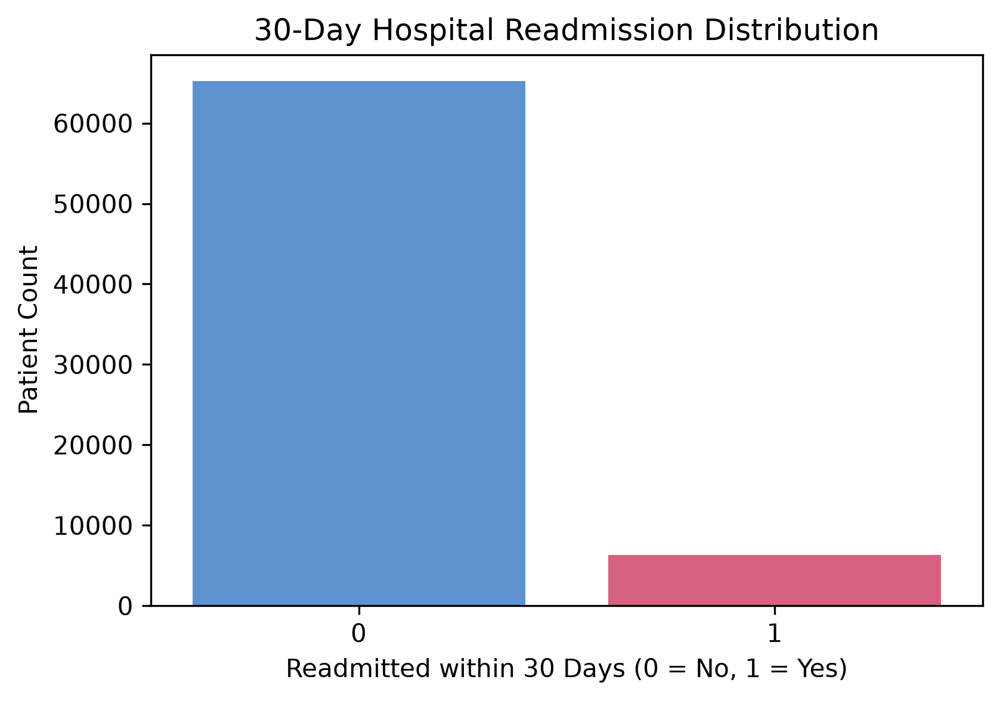
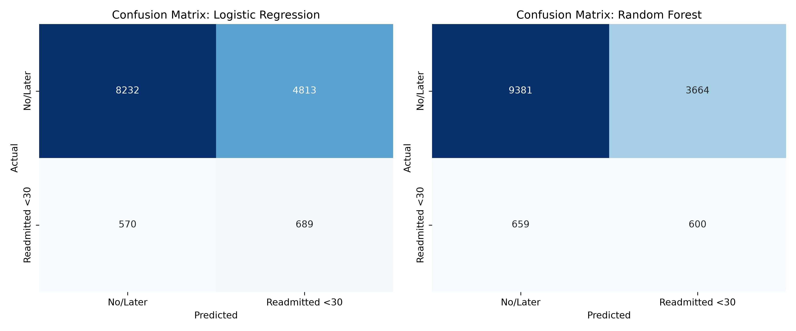
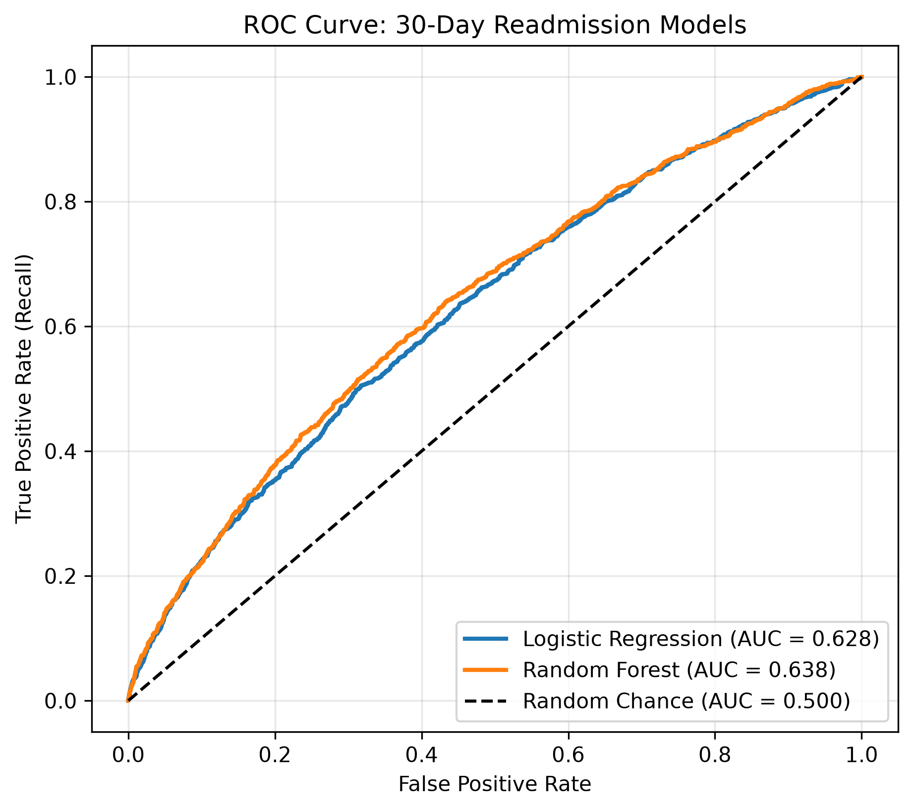
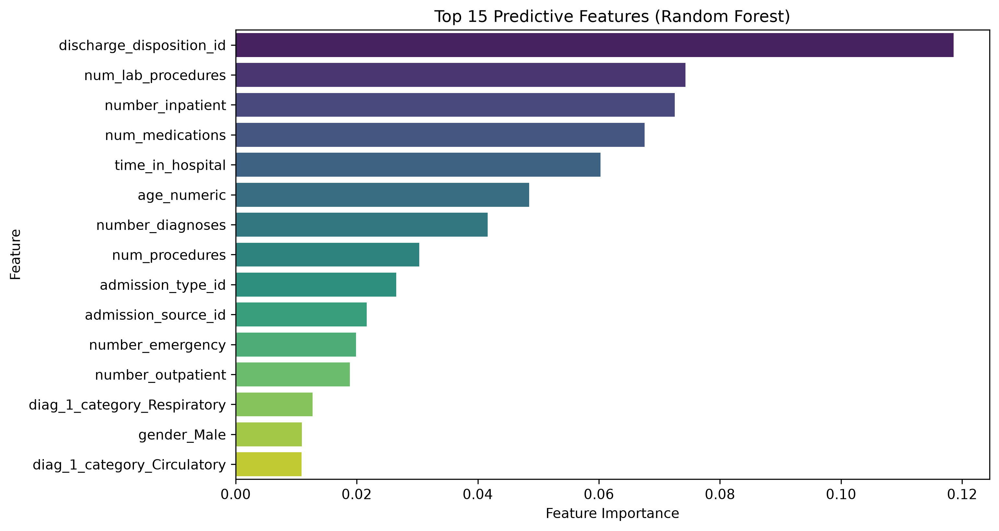

# 🏥 Healthcare Analytics: 30-Day Hospital Readmission Prediction

An end-to-end Machine Learning pipeline predicting 30-day hospital readmission risk for diabetic patients, trained on the **UCI Diabetes 130-US Hospitals Dataset (1999–2008)** (UCI ID: 296).

---

## 🎯 Clinical & Business Problem
Hospital readmissions within 30 days are a primary measure of healthcare quality. Under CMS Hospital Readmissions Reduction Program (HRRP), hospitals face substantial financial penalties for excess readmissions. 

By accurately identifying high-risk diabetic patients prior to discharge, healthcare providers can trigger targeted transition-of-care interventions (e.g., personalized medication reconciliation, nurse follow-up calls, and early outpatient visits).

* **Target Variable**: `readmitted_30` (Binary Classification)
  * **Class 1 (High Risk)**: Readmitted within `<30` days (~8.8% of encounters)
  * **Class 0 (Standard Risk)**: Readmitted `>30` days or `NO` readmission (~91.2% of encounters)

---

## 📊 Visual Insights & Performance

### 1. Class Imbalance & Readmission Distribution


### 2. Model Performance Comparison

| Metric | Logistic Regression (Balanced) | Random Forest (Balanced) | Clinical Significance |
| :--- | :---: | :---: | :--- |
| **Accuracy** | 62.4% | **69.8%** | Overall correct classification rate |
| **Recall (<30d)** | **54.7%** | 47.7% | **Crucial Metric**: % of readmissions successfully caught |
| **Precision (<30d)**| 12.5% | **14.1%** | Positive predictive value under severe imbalance |
| **ROC-AUC** | 0.628 | **0.638** | Overall discrimination capability across thresholds |

### 3. Model Evaluation Charts
| Confusion Matrices | ROC-AUC Curves |
| :---: | :---: |
|  |  |

### 4. Top Predictive Clinical Features


**Key Drivers Identified**:
- Inpatient visits in preceding year (`number_inpatient`)
- Total number of diagnoses (`number_diagnoses`)
- Length of hospital stay (`time_in_hospital`)
- Emergency room visits (`number_emergency`)
- Total medications prescribed (`num_medications`)

---

## 📂 Project Structure

```text
Healthcare Project/
├── .venv/                         # Isolated Python virtual environment
├── artifacts/                     # Visualizations & serialized models
│   ├── class_distribution.png
│   ├── confusion_matrices.png
│   ├── roc_curves.png
│   ├── top_features.png
│   └── best_rf_model.joblib
│
├── healthcare_analytics_uci.py    # Complete ML pipeline (cleaning, training, eval)
├── requirements.txt               # Dependencies
├── .gitignore                     # Git ignore rules
└── README.md                      # Project documentation
```

---

## 🛠️ Getting Started

### 1. Clone the Repository
```bash
git clone https://github.com/<your-username>/<your-repo-name>.git
cd "Healthcare Project"
```

### 2. Set Up Virtual Environment & Dependencies
```powershell
python -m venv .venv
.\.venv\Scripts\Activate.ps1
pip install -r requirements.txt
```

### 3. Run the ML Pipeline
```powershell
python healthcare_analytics_uci.py
```
Outputs, evaluation metrics, and updated plots will automatically regenerate in the `artifacts/` folder.
